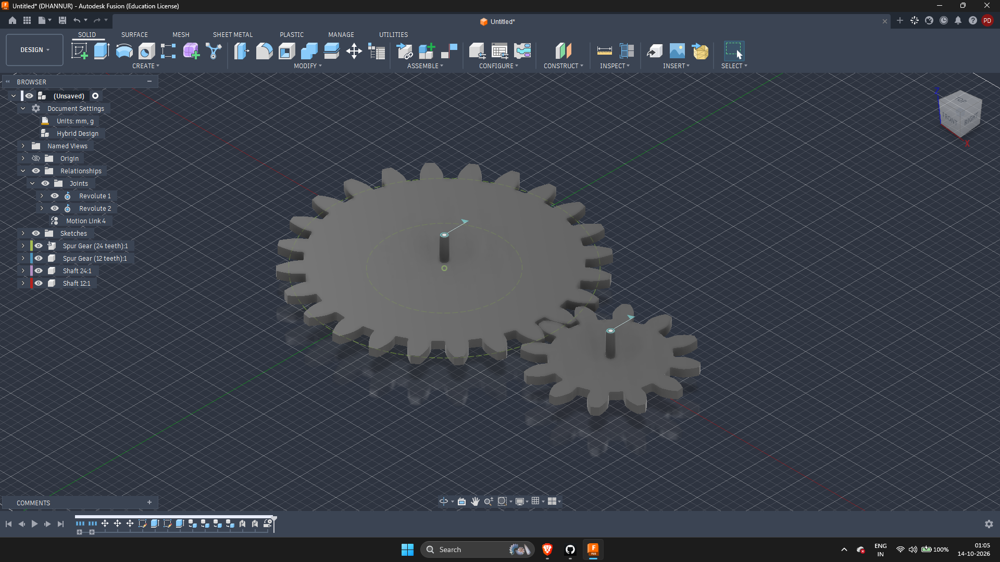

# 8. Spur Gear

## Aim
To design a pair of meshing spur gears in Fusion 360 with a 2:1 gear ratio, including the calculations, and to animate the gears in the work environment.

## Brief
| Parameter | Value |
|-----------|-------|
| Gear ratio | 2:1 |
| Module (m) | 3 mm |
| Pressure angle (α) | 20° |
| Material | Steel |

## Background

### Spur gears
Spur gears have straight teeth parallel to the shaft axis and are used to transmit motion between parallel shafts. The smaller gear is the **pinion** and the larger one is the **gear**.

### Key terms
| Term | Meaning |
|------|---------|
| Module (m) | Pitch diameter divided by number of teeth. Two gears must have the same module to mesh |
| Pressure angle | Angle between the line of force and the tangent to the pitch circle, 20° as standard |
| Pitch circle | The imaginary circle where the two gears effectively roll against each other |
| Addendum | Height of the tooth above the pitch circle |
| Dedendum | Depth of the tooth below the pitch circle |
| Gear ratio | Teeth on the driven gear divided by teeth on the driving gear |

## Design
The model is a pair of spur gears on separate shafts: a **12-tooth pinion** and a **24-tooth gear**. Their teeth ratio is 24 : 12 = **2 : 1**, so the pinion turns twice for every turn of the large gear.

## Components
Each part is a separate component so that it can take a joint.

| Component | Role |
|-----------|------|
| `Spur Gear (12 teeth):1` | Pinion (driving gear) |
| `Spur Gear (24 teeth):1` | Gear (driven gear) |
| `Shaft 12:1` | Shaft for the 12-tooth gear |
| `Shaft 24:1` | Shaft for the 24-tooth gear |

## Joints
| Relationship | Purpose |
|--------------|---------|
| Revolute 1 | Lets one gear rotate about its shaft |
| Revolute 2 | Lets the other gear rotate about its shaft |
| Motion Link 4 | Links the two rotations so that they turn together at the 2:1 ratio |

## Calculations
Formulas (module m = 3 mm, pressure angle 20°, z = number of teeth):

| Quantity | Formula |
|----------|---------|
| Gear ratio | z₂ / z₁ |
| Pitch diameter | d = m × z |
| Outside diameter | d_o = m × (z + 2) |
| Root diameter | d_r = m × (z − 2.5) |
| Base circle diameter | d_b = d × cos 20° |
| Addendum | a = m |
| Dedendum | b = 1.25 × m |
| Circular pitch | p = π × m |
| Centre distance | C = (d₁ + d₂) / 2 |

Results for the 12-tooth and 24-tooth gears:

| | Pinion (12T) | Gear (24T) |
|---|---|---|
| Pitch diameter | 36 mm | 72 mm |
| Outside diameter | 42 mm | 78 mm |
| Root diameter | 28.5 mm | 64.5 mm |
| Base circle diameter | 33.83 mm | 67.66 mm |

- Gear ratio = 24 / 12 = **2 : 1**
- Addendum = 3 mm, dedendum = 3.75 mm
- Circular pitch = π × 3 = 9.42 mm
- Centre distance = (36 + 72) / 2 = **54 mm**

## Animation
The gears are animated by driving the revolute joint of the pinion (right-click the joint in the browser and choose Drive Joints). The motion link makes the larger gear follow at half the speed and in the opposite direction, so the 2:1 ratio can be seen as the gears mesh.

## Steps
1. Generate the two gears with Fusion 360's Spur Gear add-in, with module 3 mm and pressure angle 20°.
2. Model a shaft for each gear as its own component.
3. Place the gears so that their teeth mesh at the centre distance.
4. Add a revolute joint for each gear on its shaft.
5. Add a motion link between the two revolute joints to set the 2:1 ratio.
6. Drive the pinion joint to animate the gears.

## Notes
- Two gears only mesh if they have the same module and pressure angle.
- The centre distance has to be exactly half the sum of the pitch diameters, or the gears will bind or have too much backlash.
- A motion link is what makes the second gear follow the first. Without it the two revolute joints would move independently.
- Material: steel, which is used for gears because it resists tooth wear and bending.
- What this task covers: spur gear geometry, the add-in, components, revolute joints, motion links and animation.
