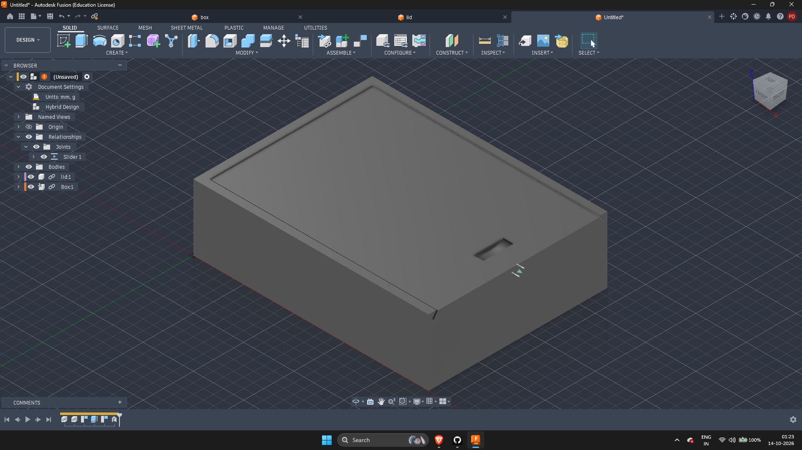
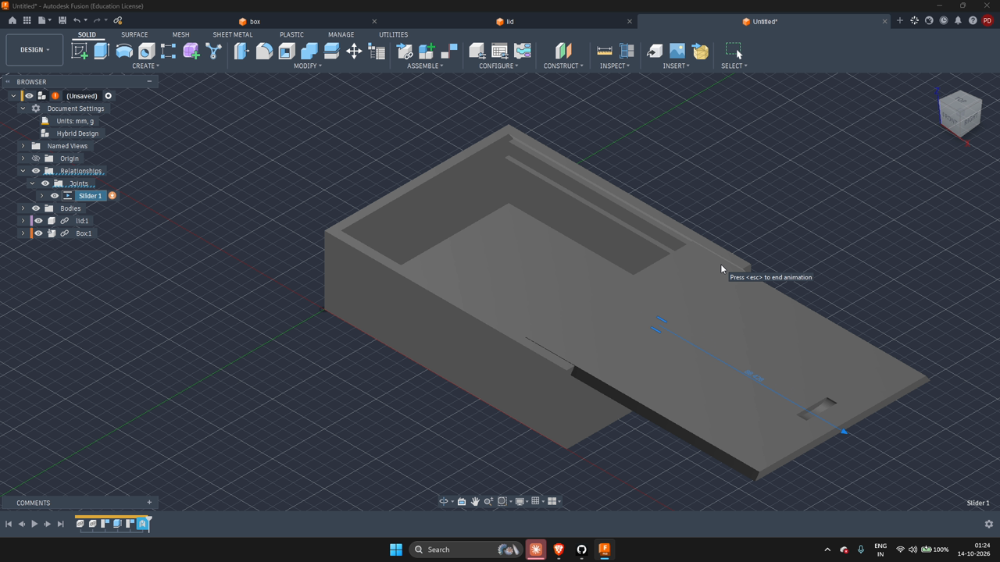

# 9. Designing a Parametric Box

## Aim
To design a parametric box in Fusion 360 with threads, and to design lids for it with snap joints and slide joints, then assemble and animate them.

## Brief
| Parameter | Value |
|-----------|-------|
| Box dimensions | 9 × 7 × 8 cm (written as "978 cm" in the task) |
| Box | Threaded |
| Lids | Snap joint and slide joint versions |
| Output | Assembled and animated |

## Background

### What is a parametric design?
In a parametric design, the dimensions are stored as named **parameters** (for example `length`, `width`, `wall`) and the model is built from them. Changing one value updates the whole model, so one box design can be resized or reused without redrawing it. In Fusion 360, parameters are managed in Modify > Change Parameters.

### Lid types
| Lid type | How it works | Good for |
|----------|--------------|----------|
| Slide lid | The lid slides in grooves cut into the box walls, in a straight line | Simple opening, no threads or clips, easy to print |
| Snap-joint lid | Small hooks or bumps on the lid click into matching features on the box | Quick closing and opening, no separate parts |
| Threaded lid | The lid screws onto matching threads on the box | A tight, secure seal |

## Design: box with sliding lid
This model is a box with a **sliding lid**. The lid sits in grooves along the top of the box and slides in a straight line to open and close. A small rectangular finger notch on the lid gives a place to push it with a fingertip.

## Components
The box and the lid are separate parts, each made as its own component and linked into the assembly from its own file:

| Component | Role |
|-----------|------|
| `Box:1` | The box body, with grooves for the lid |
| `lid:1` | The sliding lid with a finger notch |

## Joint
A **Slider** joint (`Slider 1`) connects the lid to the box. It lets the lid move in one straight line only, along the grooves, and nowhere else.

## Animation
The lid is animated by driving the slider joint, so it slides out of the grooves and then back in again.

The screen recording shows the full open and close motion:

[sliding_lid_animation.mp4](video/sliding_lid_animation.mp4)

## Steps
1. Create the box and the lid in separate files, so that each can be edited on its own.
2. Define the box dimensions as parameters and build the box and the lid grooves from them.
3. Model the lid to fit in the grooves, and add a finger notch.
4. Insert both parts into one assembly design.
5. Add a slider joint between the lid and the box.
6. Drive the slider joint to animate the lid opening and closing.

## Notes
- Building the box and lid in separate files makes each easier to modify, and the assembly updates when they change.
- Parameters let one design produce boxes of different sizes by changing a few numbers.
- A slider joint is the right joint here because the lid moves along a single straight line.
- A small clearance between the lid and the grooves lets the lid slide without sticking, which matters if the box is 3D printed.
- What this task covers: parametric modelling, slide lids, linked components, slider joints and animation in Fusion 360.
